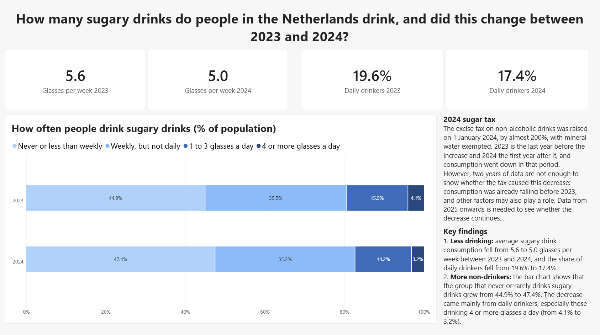
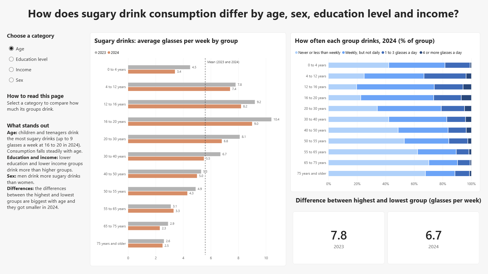
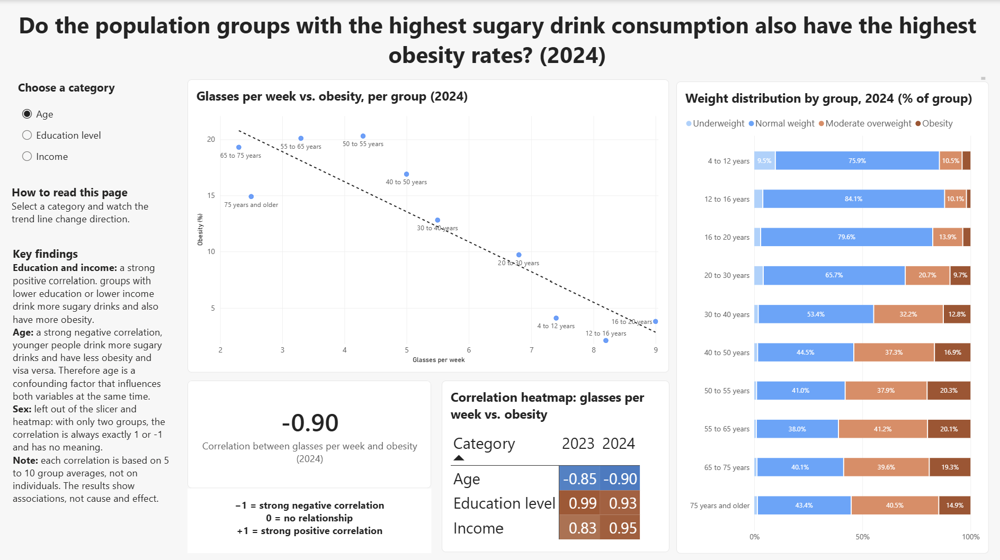

# Sugary Drinks & Obesity in the Netherlands

**A Power BI dashboard on SDG indicator 3.4.1, built from CBS Health Survey data (2023–2024).**

*Power BI · Power Query (M) · DAX · CBS StatLine open data*

[View the repository on GitHub](https://github.com/YOUR-USERNAME/sugary-drinks-dashboard) · [Back to portfolio](../)

---

## The problem

On 1 January 2024 the Dutch government raised the excise duty on non-alcoholic drinks by almost 200%, with the aim of reducing sugar intake. Sugary drinks are a major source of added sugar in the Dutch diet, and they are linked to two of the four disease groups behind SDG indicator 3.4.1: cardiovascular disease and type 2 diabetes.

National surveys show consumption is falling, but the figures are scattered across separate tables and reports. It is hard to see how consumption developed around the tax increase, which population groups drink the most, and whether those same groups also have higher obesity rates.

I built a dashboard that brings consumption and obesity together in one interactive overview, so a non-technical user can compare population groups and explore the relationship between the two.

**Research question:** How did sugary drink consumption in the Netherlands change between 2023 and 2024, how does it differ between population groups, and how does this relate to obesity?

## The data

CBS StatLine table [85457NED, *Leefstijl; persoonskenmerken*](https://opendata.cbs.nl/#/CBS/nl/dataset/85457NED), based on the annual Health Survey run by CBS and RIVM. Two CSV exports (2023 and 2024), 41 rows each, covering weight distribution and sugary drink consumption per population group.

The raw data needed real work before it was usable:

- Every number was stored as text, padded with spaces, with `.` as the missing-value marker.
- Population group and category were jammed into a single column (`Geslacht: Mannen`).
- Age groups overlapped — both 12–16 and 12–18 were present, so using all of them would count the same people twice.
- Labels were in Dutch, and the groups sorted alphabetically rather than from young to old.
- The frequency categories had a gap: there was no column for people who drink weekly but not daily.

After cleaning in Power Query, the model is one flat table of 50 rows (25 population groups × 2 years) and 16 columns.

## Approach

**One flat table, no relationships.** All variables come from the same CBS table and describe the same groups, so a star schema would have added complexity without adding anything.

**A hand-written Pearson correlation in DAX.** DAX has no correlation function. Power BI's built-in quick measure exists, but it didn't exclude the "Unknown" education group and handled blanks inconsistently, so I wrote the coefficient out step by step with `AVERAGEX` and `SUMX`. Because it responds to filter context, the same measure returns a separate value per category and per year — which is what made the heatmap possible.

**Range over standard deviation.** For dispersion I chose the range because the audience includes parents and school staff. It is easier to read, at the cost of depending on only two groups.

**One category at a time.** Age, education and income can't share a scatter plot without producing a meaningless cloud, so a slicer controls which category is plotted and the correlation card updates with it.

## What I found

Consumption fell from **5.6 to 5.0 glasses per week** between 2023 and 2024, and the share of daily drinkers fell from 19.6% to 17.4%. The decrease came mainly from the heaviest drinkers: the group drinking four or more glasses a day shrank from 4.1% to 3.2%.

The differences between groups are much larger than the change over time. Consumption peaks at **9.0 glasses per week among 16- to 20-year-olds** and falls steadily with age. Men drink more than women, and consumption falls as education and income rise. Age produces about three times the spread of education, income or sex.

The relationship with obesity depends entirely on which groups you compare. For **education (r = +0.93)** and **income (r = +0.95)**, the groups that drink the most also have the most obesity. For **age the correlation reverses (r = −0.90)** — young people drink the most but have the least obesity.

That reversal is the most interesting result in the project, and it is a textbook confounder rather than a finding about sugary drinks. Obesity accumulates over a lifetime, so it peaks in older people, while consumption peaks in teenagers. Age drives both variables in opposite directions. Reading the age correlation at face value would suggest sugary drinks protect against obesity, which is why the dashboard explains the pattern on the page rather than leaving the number to speak for itself.

## What I'd do differently

**Two years is not enough to say anything about the tax.** The dashboard states this explicitly instead of implying a causal story, but it does mean the most topical question I started with is one the data can't answer. Given the choice again I'd pick a question the available data can actually close.

**Self-reported data undercuts both variables.** People under-report sugary drinks and under-report their weight. Soft drink sales or price data would be a more objective measure of consumption.

**The correlations rest on very few points.** Each one is computed over 5 to 10 group averages, so a single unusual group moves the coefficient noticeably. I'd want confidence margins — CBS publishes them, and I didn't include them in the download.

**I rebuilt the sort order twice.** My first attempt referenced the index column before the step that created it. Reading the Applied Steps as a sequence rather than a list of settings is the main Power Query lesson I took from this.

---

## Want more detail?

The full repository has the `.pbix` file, the raw and cleaned data, the complete design document and an end-user guide.

[View on GitHub](https://github.com/YOUR-USERNAME/sugary-drinks-dashboard)

*Built as an individual assignment for Applied Data Science & Artificial Intelligence, Breda University of Applied Sciences. Data © Centraal Bureau voor de Statistiek, used under CBS open data terms.*
